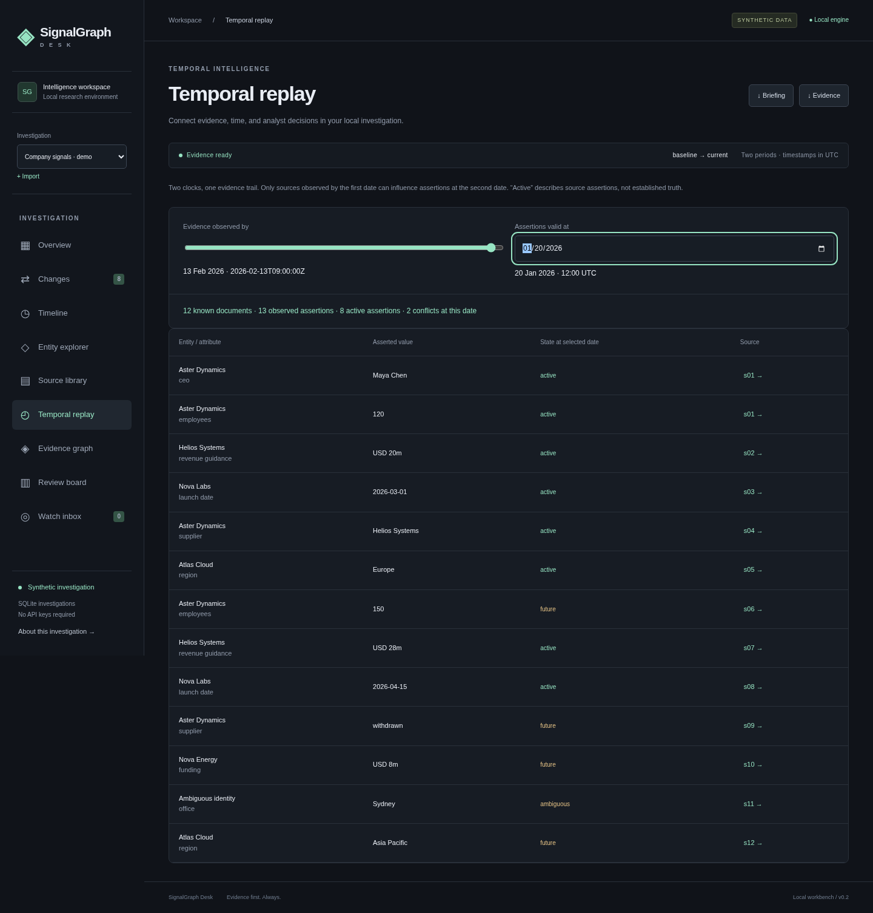
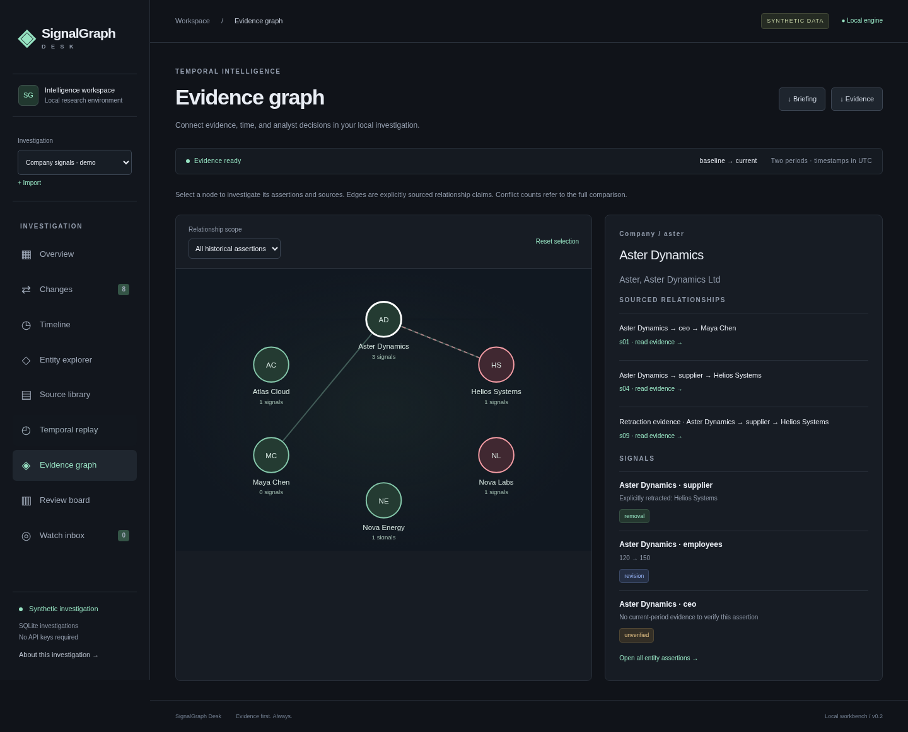
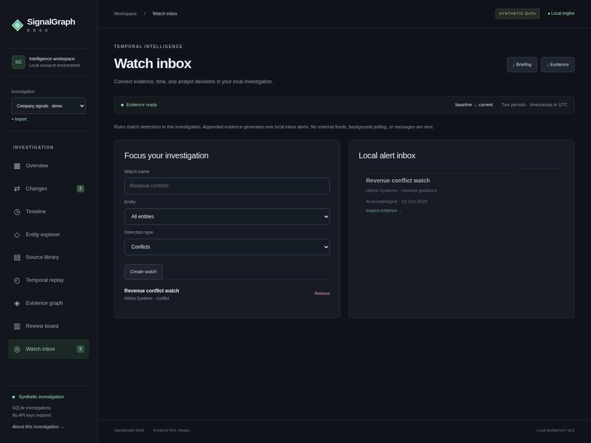

# SignalGraph Desk

**A local evidence workbench for understanding what changed, what conflicted, and what you knew at the time.** Built as a self-contained Graphiti fork application, evolved from SignalGraph Lite.

Use it for vendor due diligence, company research, product announcements, policy changes, or a technical showcase. Import structured evidence, inspect exact source excerpts, replay history, review signals, create focused watches, and export a briefing. It does not extract facts from arbitrary prose or determine factual truth.

## Start in one command

```bash
git clone --branch feature/signalgraph-lite https://github.com/TT27/SignalGraph.git
cd SignalGraph
python -m examples.signalgraph_lite.server
```

Open **http://127.0.0.1:8765**. Python 3.10+; no installation, internet connection, API key, LLM, Neo4j or JavaScript build required. All browser assets are local. Ctrl+C stops the server.

```bash
python -m examples.signalgraph_lite.server --port 8766 --db work/signalgraph/research.sqlite3
```

The default database is `work/signalgraph/workspace.sqlite3`, ignored by Git. The server binds only to loopback. Copy the database **while the server is stopped** to back up investigations and review history. Exported JSON contains evidence, review metadata and watches; the separate dataset download is the round-trip import format. Database schema versioning and multi-user authentication are not implemented; this is a local single-user tool.

## A useful investigation workflow

1. Start with the labelled company demo: **12 documents, 6 entities, 13 assertions, 8 detections** (4 changes, 2 contradictions, 2 unverified).
2. Open **Changes**, filter conflicts, and inspect both excerpts, source dates, validity windows, a word diff, and the text fingerprint.
3. Save an analyst decision and rationale. The **Review board** tracks open, investigating, resolved and dismissed signals; original evidence remains intact.
4. Move the two **Temporal replay** controls independently. A later publication cannot leak into an earlier observation-time state.
5. Select a node in **Evidence graph** to follow explicitly sourced relationships. Scope edges to active assertions at the replay dates.
6. Create an entity/type watch in **Watch inbox**. Existing matches appear once; appended evidence generates new matching alerts. Acknowledgements survive restart. Alerts are local, with no background polling or external messages.
7. **Import** your own structured dataset as a separate investigation. Switch investigations from the sidebar; their notes, watches and alerts are isolated.
8. Download a **Markdown briefing** containing detections, review notes, exact evidence, source identifiers and a SHA-256 manifest. JSON evidence export is also available.

All counts and summaries are computed from the selected investigation. Synthetic and imported provenance are visibly distinguished. No statistical confidence is invented. Resolving a conflict is an analyst annotation, not a claim that the engine has established truth.

## Bring your own evidence

Click **+ Import** and choose a JSON file or paste JSON. “Use current dataset as template” provides a valid example; “Download dataset” saves the import format. The original demo remains a separate fixed investigation.

The format has exactly two named comparison periods and analyst-labelled claims:

```json
{
  "periods": ["baseline", "current"],
  "entities": [
    {"id": "vendor", "name": "Example Vendor", "kind": "Company", "aliases": ["Vendor"]}
  ],
  "documents": [
    {
      "id": "source-1",
      "title": "Illustrative baseline announcement",
      "publisher": "Demo publisher",
      "observed_at": "2026-01-05T09:00:00Z",
      "period": "baseline",
      "body": "Example Vendor has 10 employees.",
      "uri": "fixture://example/source-1",
      "synthetic": true
    },
    {
      "id": "source-2",
      "title": "Illustrative correction",
      "publisher": "Demo publisher",
      "observed_at": "2026-02-05T09:00:00Z",
      "period": "current",
      "body": "Example Vendor now has 12 employees, correcting its earlier count.",
      "uri": "fixture://example/source-2",
      "synthetic": true
    }
  ],
  "claims": [
    {
      "id": "claim-1", "entity": "vendor", "predicate": "employees", "value": "10",
      "source_id": "source-1", "quote": "Example Vendor has 10 employees.",
      "valid_from": "2026-01-01T00:00:00Z"
    },
    {
      "id": "claim-2", "entity": "vendor", "predicate": "employees", "value": "12",
      "source_id": "source-2",
      "quote": "Example Vendor now has 12 employees, correcting its earlier count.",
      "valid_from": "2026-02-01T00:00:00Z", "supersedes": "claim-1"
    }
  ]
}
```

This example is synthetic. For your real evidence, supply its actual source text, observed date, URI and `synthetic: false`; do not invent citations. Source authenticity and the meaning of labelled assertions remain your responsibility. The app validates types, IDs, exact quote substrings, timestamps, validity intervals and supersession references, and refuses partial invalid imports.

Optional claim fields: `valid_to`, `target` (relationship entity), `retracted` and `supersedes`. Entities resolve by authoritative ID or unique normalized alias; shared aliases remain ambiguous. IDs use 1–128 letters, digits, dots, underscores or hyphens. Each attribute must be single-valued; values and predicates are strings. No fuzzy extraction or numeric-unit equivalence is assumed.

**Append evidence:** choose “Append immutable evidence” to add a self-contained dataset or complete updated dataset to the active imported investigation. Comparison periods must match. Identical records are ignored; an existing ID with different content is rejected atomically. Link new corrections to old claims by including those referenced claims and sources in the payload. Original source records cannot be rewritten. A new investigation is required to correct an erroneous original import. Demo evidence is fixed and cannot be appended to.

Limits: 4 MiB request body, 1,000 documents, 1,000 entities, 5,000 claims. Pairwise conflict analysis and the small SVG renderer are designed for modest investigations, not enterprise scale. Keep local evidence and databases out of commits.

## Two clocks and detection semantics

- **Observed source timestamp:** when the source was published or observed, supplied in `observed_at`.
- **Asserted validity:** when a claim says it applies, supplied in `valid_from / valid_to`.
- **Replay:** sources are visible only when observed at or before the selected cutoff. Assertions may then be active, future, expired, superseded, ambiguous, or a retraction at the selected validity instant.

The browser's validity control uses noon UTC on the chosen date; the API accepts a full timezone-aware instant. Validity intervals are half-open `[from, to)`, so touching endpoints do not overlap. An observed explicit correction retires the linked earlier assertion starting at the correction's validity start, without hiding its earlier history. “Active” means an applicable source assertion, not verified truth. Open-ended validity does not prove continued truth.

| Detection | Rule |
|---|---|
| Addition | Attribute newly observed in the later comparison period; not proof of prior falsity |
| Revision | Explicit supersession, or different values in non-overlapping validity windows |
| Removal | Explicit retraction linked to an earlier assertion |
| Conflict | Different values for a single-valued entity attribute with overlapping validity and no explicit retirement |
| Unverified | No later evidence, ambiguous identity, or unlinked retraction |

The Changes view covers the complete two-period comparison; Temporal replay reconstructs knowledge for its selected clocks. The Source timeline remains publication chronology. Review status does not alter counts, detection logic or source text. Resolution/dismissal requires rationale; optimistic version checks reject stale edits, and review history is append-only in the app. It is a local audit history, not a tamper-proof log.

## Architecture

```text
Validated JSON / fixed fixture
  → immutable source, entity and claim models
  → SQLite investigations with immutable append semantics
  → deterministic comparison / two-clock replay
  → local HTTP JSON API
  → original responsive browser workspace + SVG evidence graph
  → analyst review history / local watch inbox / Markdown briefing
```

`engine.py` validates and compares; `temporal.py` reconstructs two-clock states; `store.py` isolates investigations, reviews, watches and deduplicated alerts; `briefing.py` generates word diffs and source-linked Markdown; `server.py` serves a bounded loopback API. `app.js` retains the original evidence navigation; `workspace.js` adds the persistent workflows. Writes require JSON and reject cross-origin requests. Source hashes identify exact stored text, not publisher authenticity.

[RESEARCH.md](RESEARCH.md) documents primary-source research into changedetection.io, OpenCTI, Datasette, Cytoscape.js and Graphiti, plus the design choices and limits. No third-party implementation code or assets were copied. Browser-native SVG was chosen for a small dependency-free graph; no relationships are inferred.

### Local API

All investigation-scoped GET endpoints accept `?workspace=<id>` (default `demo`). POST bodies include `workspace` when appropriate.

| Endpoint | Purpose |
|---|---|
| `GET /api/workspaces` | List investigations |
| `GET /api/snapshot` | Computed detections, source fingerprints, reviews, watches, alerts and history |
| `GET /api/dataset` | Raw dataset for round-trip import |
| `GET /api/replay` | Use `/api/replay?workspace=…&observed_until=…&valid_at=…` to reconstruct two-clock assertions |
| `GET /api/briefing` | Deterministic Markdown report |
| `POST /api/import` | `{name, dataset}` → new investigation |
| `POST /api/append` | `{workspace, dataset}` → atomic append |
| `POST /api/review` | `{workspace, event_id, status, note, version}` → review; stale version returns 409 |
| `POST /api/watch` | `{workspace, label, entity_id, kind}` → watch (`entity_id: null` means all) |
| `POST /api/watch/remove` | `{workspace, id}` → remove rule and its alerts |
| `POST /api/alert/acknowledge` | `{workspace, watch_id, event_id}` → acknowledge alert |

## Optional Graphiti adapter — externally unverified

The original adapter uses actual supported `Graphiti.add_episode`, `EpisodeType.json`, source descriptions, `reference_time` and graph partitions. It is independent of the offline workbench and propagates real failures. Graphiti's episode provenance and temporal edge conventions informed this application; the offline engine does not import its LLM pipeline. No Graphiti core files or upstream dependency manifests are changed.

Configure Graphiti following its upstream instructions, with an actual supported model and reachable database. Default configuration needs `OPENAI_API_KEY` and Neo4j 5.26+. Set `NEO4J_URI`, `NEO4J_USER`, `NEO4J_PASSWORD` and `GRAPHITI_TELEMETRY_ENABLED=false`; never commit credentials. Then call `ingest_episodes(client, load_dataset())` from `graphiti_adapter.py` with your configured client. The adapter returns real episode UUIDs. Real external ingestion, returned edge mapping, exact model extraction and idempotent Graphiti round trips remain unverified/future work.

## Checks and measured evaluation

From the repository root:

```bash
python -m unittest discover -s examples/signalgraph_lite/tests -p 'test_*.py' -v
python -m examples.signalgraph_lite.evaluate
```

Optional developer tools, consistent with upstream:

```bash
python -m pip install pytest==9.1.1 ruff==0.17.0 pyright==1.1.414
python -m pytest -c /dev/null --confcutdir=examples/signalgraph_lite examples/signalgraph_lite/tests -q
python -m ruff check examples/signalgraph_lite
python -m ruff format --check examples/signalgraph_lite
python -m pyright --project examples/signalgraph_lite/pyrightconfig.json
node --check examples/signalgraph_lite/static/app.js
node --check examples/signalgraph_lite/static/workspace.js
```

Use unittest on Windows or replace `/dev/null` with an empty pytest config. The isolated pytest command avoids unrelated root database fixtures. Pyright checks the app and adapter; optional browser runners need Playwright and are verified by execution. Root core/DB suites are separate and have not been run.

Latest automated result: **60 passing tests**. The fixture's independently labelled exact-match evaluation remains **8 expected, 8 predicted, 8 true positives, 0 false positives/negatives; precision 1.0 and recall 1.0**. This is a small synthetic regression measurement, not real-world accuracy. Temporal and persistence tests add correctness checks rather than inventing accuracy measurements for imported data.

### Browser validation and real screenshots

```bash
python -m pip install playwright==1.62.0
python -m playwright install chromium
python examples/signalgraph_lite/tests/desk_smoke.py --artifacts work/desk-captures
```

The runner starts an ephemeral server and disposable database, imports test evidence, reviews a signal, checks two-clock replay, inspects the graph, creates/acknowledges a watch, downloads a briefing and checks mobile layouts. It leaves your real investigations untouched. Set `CHROMIUM_EXECUTABLE=/path/to/chromium` to use installed Chromium. The original `browser_smoke.py` still tests the basic navigation against a running server.








See [WALKTHROUGH.md](WALKTHROUGH.md) for the 60-second showcase and [MORNING_REVIEW.md](../../MORNING_REVIEW.md) for delivery results. Apache-2.0, consistent with the fork. SignalGraph Desk is an original application, not an official Zep product.
