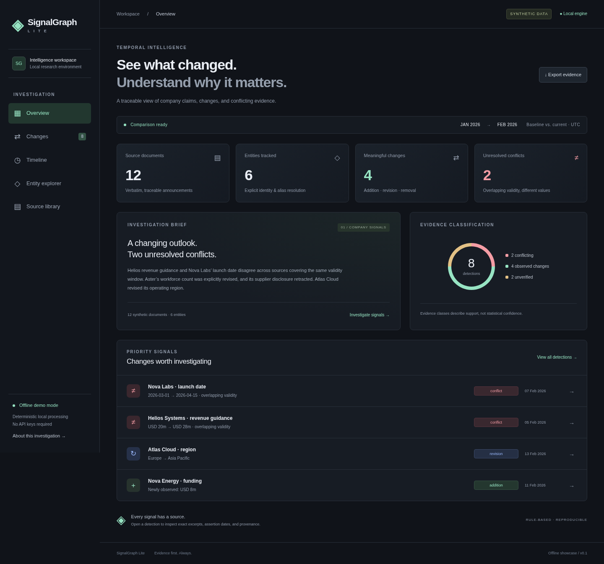
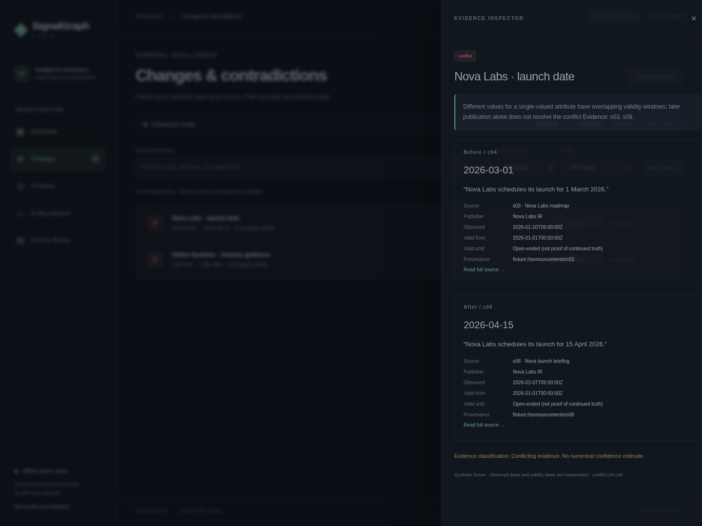
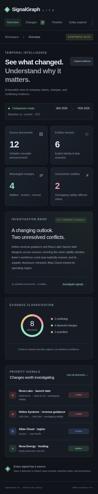

# SignalGraph Lite

An original, self-contained Graphiti example for inspecting how company intelligence changes over time. A dark, responsive investigation workspace connects every detection to exact source evidence. All announcements and companies in the demo are fictional.

## Start the offline demo

From the **Graphiti repository root**, with Python 3.10+:

```bash
python -m examples.signalgraph_lite.server
```

Open **http://127.0.0.1:8765**. Stop with Ctrl+C. If the port is busy:

```bash
python -m examples.signalgraph_lite.server --port 8766
```

No installation, API key, internet access, LLM, or Neo4j is needed. The server binds to loopback and serves only explicitly allowlisted assets. The fixture is reprocessed on each snapshot request. This is a local demonstration server, not a production service. All browser assets are local; no CDN fonts, analytics, or external feeds.

## Explore

- **Overview:** 12 documents, 6 entities, 4 observed changes, 2 unresolved contradictions, 2 unverified claims.
- **Changes:** search and filter all 8 detections; inspect before/after quotations and provenance.
- **Timeline:** scrub through publication dates. This is a source chronology with full-comparison detections, not a point-in-time reconstruction.
- **Entity explorer:** explicit identities, shared aliases, relationship assertions, validity windows, and source links. Retracted relationships remain visible as historical evidence.
- **Source library:** complete synthetic documents with local `fixture://` identifiers.
- **Export evidence:** download the actual locally computed JSON snapshot.

The evidence drawer uses a native modal dialog with keyboard dismissal, focus restoration, and labelled controls. Empty results, an empty fixture, loading, HTTP failures, and retry are handled explicitly.

## Architecture and data flow

```text
fixtures/announcements.json
  → immutable typed dataclasses + timestamp/provenance validation
  → explicit ID / normalized alias resolution
  → pure temporal comparison rules
  → JSON snapshot with claim IDs and source IDs
  → loopback HTTP API
  → vanilla JavaScript investigation workspace
```

`models.py` defines source documents, entities, claims, relationships (claims with a target), and change events. Sources contain **observed_at** (publication/observation timestamp); claims have **valid_from / valid_to** (asserted validity). All timestamps must carry a timezone and compare as instants. Validity intervals are half-open `[from, to)`; touching endpoints do not overlap. Observation date never silently replaces validity date. Open-ended validity does not prove continued truth.

`engine.py` is deterministic and independent of Graphiti imports. Claims are **analyst-labelled structured fixture data**, not automated natural-language extraction. Exact quotes must occur in their referenced source body. Unknown or shared aliases remain unverified; explicit IDs are authoritative. Whitespace/case normalization is used, not fuzzy matching.

### Detection semantics

| Class | Rule | Evidence |
|---|---|---|
| Addition | Attribute first observed in current period | Current assertion; does not prove prior falsity |
| Revision | Explicit supersession, or changed value with non-overlapping validity | Earlier and later assertions |
| Removal | Explicit retraction linked to an earlier assertion | Original and retracting documents |
| Conflict | Different values for the same single-valued entity attribute, overlapping validity, no explicit retirement | Both conflicting assertions |
| Unverified | No later evidence, ambiguous identity, or unlinked retraction | Exact available sources; uncertainty stated |

An explicit supersession retires an assertion from the final comparison's unresolved-conflict candidates, while preserving its original document and claim. This assumes structured supersession links are accurate; conflicting publisher corrections need further adjudication. Attributes are single-valued, predicate names are canonical, and values compare as normalized strings. Multi-valued attributes, numeric/unit conversion, multilingual aliases, source trust scoring, and arbitrary prose extraction are out of scope. Pairwise conflict detection is quadratic within an attribute group, appropriate for this small fixture. No statistical confidence is invented.

### Upstream inspected and reused

Inspected upstream `AGENTS.md`, `README.md`, `pyproject.toml`, Apache-2.0 `LICENSE`, quickstart Neo4j example, `graphiti_core/nodes.py`, `edges.py`, and `graphiti.py` at base commit `0a3b1711b018e5590cf5c44a3ee3e67d6733ee13`. Graphiti's episode provenance and temporal edge conventions informed this model: `EntityEdge.valid_at / invalid_at` describe truth windows, while `created_at / expired_at` track database history. These are distinct from a source's observation timestamp.

The **optional adapter directly reuses** `Graphiti.add_episode`, `EpisodeType.json`, `reference_time`, source descriptions and graph partitions. The offline rules intentionally do not run Graphiti's LLM-based extraction or invalidation pipeline. No Graphiti core files or upstream dependency manifests are modified.

## Optional Graphiti adapter — external integration unverified

`graphiti_adapter.ingest_episodes(client, dataset, group_id)` takes an already configured Graphiti client. It writes source documents and structured assertions as episodes, retaining observation timestamps, asserted validity, excerpts, and synthetic provenance in JSON. It returns actual episode UUIDs; service or credential failures propagate. It does not produce offline change events or silently fall back to fixture output. Type checking verifies its use of the inspected API, but real database/LLM ingestion has not been run.

Install Graphiti as documented upstream (`uv sync --extra dev` from this fork, or `pip install graphiti-core==0.31.0`), provide a reachable Neo4j 5.26+ database and an actual supported model configuration. The default client needs `OPENAI_API_KEY`. Set `NEO4J_URI`, `NEO4J_USER`, `NEO4J_PASSWORD`, and `GRAPHITI_TELEMETRY_ENABLED=false`. Do not commit credentials. Example opt-in Python usage:

```python
import asyncio
import os

from graphiti_core import Graphiti
from examples.signalgraph_lite.engine import load_dataset
from examples.signalgraph_lite.graphiti_adapter import ingest_episodes


async def main():
    client = Graphiti(
        os.environ['NEO4J_URI'], os.environ['NEO4J_USER'], os.environ['NEO4J_PASSWORD']
    )
    try:
        await client.build_indices_and_constraints()
        ids = await ingest_episodes(client, load_dataset())
        print(ids)
    finally:
        await client.close()


asyncio.run(main())
```

This example makes real database writes and model calls when explicitly run; the offline server never invokes it. Model extraction may differ from structured labels. Episode provenance is retained, but this adapter does not guarantee exact Graphiti edge validity or identity extraction. Idempotent repeated ingest and mapping returned graph edges into the rule engine are future work.

## Validation and evaluation

Dependency-free automated tests and measured fixture evaluation, from the repository root:

```bash
python -m unittest discover -s examples/signalgraph_lite/tests -p 'test_*.py' -v
python -m examples.signalgraph_lite.evaluate
```

Or install the same tools used by upstream:

```bash
python -m pip install pytest==9.1.1 ruff==0.17.0 pyright==1.1.414
python -m pytest -c /dev/null --confcutdir=examples/signalgraph_lite examples/signalgraph_lite/tests -q
python -m ruff check examples/signalgraph_lite
python -m ruff format --check examples/signalgraph_lite
python -m pyright --project examples/signalgraph_lite/pyrightconfig.json
node --check examples/signalgraph_lite/static/app.js
```

On Windows use the `unittest` command or replace `/dev/null` with an empty local pytest config. The isolated pytest command avoids upstream database fixtures and optional LLM imports from root `conftest.py`. These checks do not require installing Graphiti. Type checking the optional adapter resolves upstream source when inside this fork. Root `make test`/`make lint` and real external integrations are separate gates and have not been run; the upstream core is unchanged.

`fixtures/expected.json` contains manually labelled event types and before/after claim IDs. Evaluation compares exact signature sets, not rendered UI text. Latest result: **8 expected, 8 predicted, 8 true positives, 0 false positives, 0 false negatives; precision 1.0, recall 1.0**. This is a small synthetic regression benchmark, not an estimate of real-world accuracy.

Tests cover overlapping/non-overlapping windows, offsets and endpoint boundaries, reverse observation/validity order, explicit corrections, retractions, missing evidence, shared names, shuffled inputs, fabricated excerpts, duplicate IDs, malformed timestamps, and HTTP/error handling.

### Browser smoke and screenshots

With the server running in another terminal:

```bash
python -m pip install playwright==1.62.0
python -m playwright install chromium
python examples/signalgraph_lite/tests/browser_smoke.py
```

To use installed Chromium, set `CHROMIUM_EXECUTABLE=/path/to/chromium` for that command. The script checks navigation, filters, exact evidence, Escape/focus restoration, timeline scrubbing, relationships, sources, JSON export, mobile overflow, empty data, and failure retry. Use `--url` for another port and `--artifacts` for the screenshot directory. Captured with system Chromium at 1440×1080 and 390×844:





## 60-second showcase

See [WALKTHROUGH.md](WALKTHROUGH.md) for a timed script and honest measurement framing. [MORNING_REVIEW.md](../../MORNING_REVIEW.md) records completion, checks, and next work.

## License

Apache-2.0, consistent with the upstream repository. SignalGraph Lite is an original example, not an official Zep product. Upstream attribution and licensing remain unchanged.
